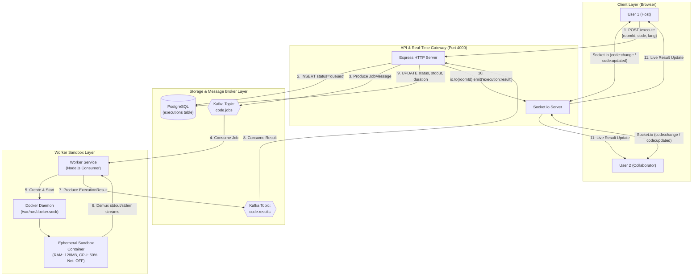

# ⚡ DevRoom — Complete Architectural Guide & Interview Handbook

> **DevRoom** is a distributed, real-time collaborative code editor and secure sandbox execution engine. It allows multiple developers to write code simultaneously in a shared virtual room, trigger isolated cloud executions across multiple languages (Python, JavaScript, Java), and view streamed output live without blocking or server vulnerability.

---

## Table of Contents

1. [Executive Summary & 30-Second Pitch](#1-executive-summary--30-second-pitch)
2. [Core Features](#2-core-features)
3. [System Architecture & Data Flow](#3-system-architecture--data-flow)
4. [Component Deep-Dive](#4-component-deep-dive)
   - [Frontend Client (React + Monaco Editor + Tailwind)](#41-frontend-client)
   - [API Gateway & WebSocket Server (Node.js + Express + Socket.io)](#42-api-gateway--websocket-server)
   - [Message Broker (Apache Kafka & Zookeeper)](#43-message-broker-apache-kafka)
   - [Worker & Execution Engine (Node.js + Dockerode)](#44-worker--execution-engine)
   - [Database (PostgreSQL)](#45-database-postgresql)
5. [Security & Sandbox Isolation Model](#5-security--sandbox-isolation-model)
6. [Why This Tech Stack? (Design Decisions & Trade-Offs)](#6-why-this-tech-stack-design-decisions--trade-offs)
7. [Comprehensive Interview Questions & Answers](#7-comprehensive-interview-questions--answers)
   - [Category 1: System Design & Distributed Systems](#category-1-system-design--distributed-systems)
   - [Category 2: Security & Sandboxing](#category-2-security--sandboxing)
   - [Category 3: Real-Time WebSockets & Concurrency](#category-3-real-time-websockets--concurrency)
   - [Category 4: Database & Data Modeling](#category-4-database--data-modeling)
   - [Category 5: Production Readiness & Scale](#category-5-production-readiness--scale)
8. [Failure Modes & Edge Cases Handled](#8-failure-modes--edge-cases-handled)
9. [Future Roadmap & Production Scale Enhancements](#9-future-roadmap--production-scale-enhancements)

---

## 1. Executive Summary & 30-Second Pitch

### The 30-Second Elevator Pitch
> *"DevRoom is a distributed collaborative coding playground inspired by Google Docs and LeetCode. It combines a real-time multiplayer code editor with an event-driven, asynchronous execution engine. When a user runs code, the API publishes a job to Apache Kafka, decoupling the request from an isolated Docker sandbox worker that executes untrusted code with CPU, memory, and network constraints. Execution results stream back to all room participants in sub-second latency via WebSockets."*

### Key Highlights
* **Zero Main-Thread Blocking:** Long-running or infinite code loops never block the API server.
* **Hacker-Proof Sandbox:** Isolated Docker containers enforce no internet access (`NetworkDisabled: true`), a 128MB RAM ceiling, and 50% CPU quota.
* **Event-Driven Decoupling:** Kafka acts as a shock absorber during traffic spikes.
* **Real-Time Multiplayer:** Instant room-based live keystroke broadcasts and simultaneous execution result delivery.

---

## 2. Core Features

| Feature | Technical Implementation |
| :--- | :--- |
| **Multiplayer Collaborative Editing** | WebSocket (`Socket.io`) room partitioning (`room:join`, `code:change`, `code:updated`). |
| **Multi-Language Support** | Python 3.11 (`python:3.11-alpine`), Node.js 20 (`node:20-alpine`), Java 21 (`eclipse-temurin:21-jdk-alpine`). |
| **Isolated Sandbox Execution** | Ephemeral Docker containers spawned per execution via Docker Engine API (`dockerode`). |
| **Strict Resource Limits** | 128MB RAM cap (`Memory`), 50% CPU cap (`CpuQuota: 50_000`, `CpuPeriod: 100_000`), Auto-remove on exit. |
| **Execution Timeouts** | `Promise.race` with hard timeouts (10s for Python/JS, 20s for Java) + explicit container SIGKILL. |
| **Stream Demuxing** | Custom binary parser for Docker's 8-byte multiplexed header protocol separating `stdout` (type 1) and `stderr` (type 2). |
| **Persistent Execution History** | PostgreSQL table `executions` with UUID primary keys and indices on `room_id` and `created_at`. |
| **Instant Room Sharing** | URL-based room state (`?room=<id>`) with automated clipboard copy. |

---

## 3. System Architecture & Data Flow



---

## 4. Component Deep-Dive

### 4.1 Frontend Client
* **Tech:** React 19, TypeScript, Vite, Tailwind CSS, Monaco Editor (`@monaco-editor/react`), `socket.io-client`.
* **State Management & Remote Sync Protection:**
  - When User A types, an `onChange` event fires in Monaco Editor.
  - The client emits `socket.emit("code:change", { roomId, code, language })`.
  - When User B receives `code:updated`, a `useRef(isRemoteUpdate)` flag is set to `true` prior to calling `setCode()`. This prevents an infinite ping-pong echo loop back to the server.
* **Output Display:**
  - Visual status pill (`SUCCESS`, `ERROR`, `TIMEOUT`).
  - Formatted execution duration in milliseconds and exit code.
  - Isolated styled containers for `stdout` (standard white terminal text) and `stderr` (colored red).

---

### 4.2 API Gateway & WebSocket Server
* **Tech:** Node.js, Express, TypeScript, Socket.io, `pg`, `kafkajs`.
* **Endpoints:**
  - `GET /health` — Health check endpoint.
  - `POST /execute` — Accepts `{ roomId, code, language }`. Validates payload size (max 10,000 chars), generates a `UUIDv4` execution ID, inserts a record with `'queued'` state into PostgreSQL, and publishes to Kafka `code.jobs`. Returns `202 Accepted` immediately.
  - `GET /history/:roomId` — Retrieves past executions for a given room.
* **Results Consumer:**
  - An independent Kafka consumer runs inside the API process subscribed to `code.results`.
  - On arrival of an execution result:
    1. Updates PostgreSQL record: `status`, `stdout`, `stderr`, `exit_code`, `duration_ms`.
    2. Dispatches `io.to(roomId).emit("execution:result", result)` to instantly notify all room subscribers.

---

### 4.3 Message Broker (Apache Kafka)
* **Topics:**
  1. `code.jobs`: Partitioned queue holding incoming execution requests.
  2. `code.results`: Stream of completed executions produced by workers.
* **Why Kafka?**
  - **Buffering & Backpressure:** If 10,000 users click "Run" at once, the API doesn't crash or run out of memory. Jobs wait safely in Kafka until workers pick them up.
  - **Horizontal Worker Scalability:** Adding more worker instances to the same consumer group (`worker-group`) automatically distributes partitions across workers with zero downtime.

---

### 4.4 Worker & Execution Engine
* **Tech:** Node.js, TypeScript, Docker Engine API (`dockerode`).
* **Execution Lifecycle:**
  1. **Heredoc Injection:** Code is escaped to safely survive shell interpolation and written inside the container using `cat > solution.ext << 'CODEEOF'`.
  2. **Sandbox Creation:** Container is configured with:
     ```typescript
     HostConfig: {
       Memory: 128 * 1024 * 1024, // 128MB RAM limit
       CpuPeriod: 100_000,
       CpuQuota: 50_000,          // 50% CPU allocation
       AutoRemove: true           // Clean up filesystem on exit
     },
     NetworkDisabled: true        // Prevent SSRF / outbound calls
     ```
  3. **Stream Demultiplexing:** Docker multiplexes stdout and stderr into a single stream using an 8-byte framing header:
     - `Byte 0`: Stream type (`1 = stdout`, `2 = stderr`).
     - `Bytes 1-3`: Unused padding (`0x00`).
     - `Bytes 4-7`: Big-endian uint32 denoting the payload chunk length.
     - DevRoom's custom parser decodes these frames into distinct buffers in real-time.
  4. **Timeout Enforcement:**
     - Uses `Promise.race([collectOutput(container), timeoutPromise])`.
     - If timeout expires, `container.kill()` is issued immediately and status is marked as `timeout`.

---

### 4.5 Database (PostgreSQL)
* **Schema Definition:**
  ```sql
  CREATE TABLE IF NOT EXISTS executions (
      id            UUID         PRIMARY KEY DEFAULT gen_random_uuid(),
      room_id       VARCHAR(50)  NOT NULL,
      language      VARCHAR(20)  NOT NULL,
      code          TEXT         NOT NULL,
      stdout        TEXT,
      stderr        TEXT,
      exit_code     INT,
      status        VARCHAR(20)  NOT NULL, -- 'queued' | 'success' | 'error' | 'timeout'
      duration_ms   INT,
      created_at    TIMESTAMPTZ  NOT NULL DEFAULT NOW()
  );

  CREATE INDEX idx_executions_room_id    ON executions(room_id);
  CREATE INDEX idx_executions_created_at ON executions(created_at DESC);
  ```

---

## 5. Security & Sandbox Isolation Model

Running arbitrary, user-supplied code is one of the most dangerous operations in computer science. DevRoom mitigates major attack vectors as follows:

| Threat / Attack Vector | Risk | DevRoom Defense Mechanism |
| :--- | :--- | :--- |
| **Denial of Service (Infinite Loops)** | `while(True): pass` consuming 100% CPU forever. | Hard timeout (10s Python/JS, 20s Java) + `CpuQuota: 50_000` (50% single CPU core). |
| **Memory Exhaustion (RAM Bomb)** | Allocating gigabytes of arrays to crash host machine (OOM). | `Memory: 134,217,728` (Strict 128 MB RAM ceiling). Docker OOM killer terminates container without host impact. |
| **Server-Side Request Forgery (SSRF) / Port Scanning** | User code scanning local network, internal metadata endpoints (e.g. AWS 169.254.169.254), or attacking other containers. | `NetworkDisabled: true` removes container's virtual network interface (`eth0`). Outbound socket calls fail immediately with `ENETUNREACH`. |
| **Host Filesystem Tampering** | Writing malware or attempting to overwrite host files. | Ephemeral container isolation with `AutoRemove: true`. No volume mounts from host to container. |
| **Output Flooding (Stdout DoS)** | Printing millions of lines to exhaust browser memory. | Slicing stdout (`slice(0, 10_000)`) and stderr (`slice(0, 5_000)`) before emitting to Kafka. |
| **Shell Injection via Code Strings** | Escape characters escaping code payload. | Single quotes are escaped (`code.replace(/'/g, "'\\''")`) and wrapped in a quoted shell heredoc (`cat > file << 'CODEEOF'`). |

---

## 6. Why This Tech Stack? (Design Decisions & Trade-Offs)

### Why Kafka instead of direct HTTP calls to the Worker?
* **Problem with HTTP:** If traffic spikes from 10 to 1,000 executions per second, an HTTP-based worker pool will get overwhelmed, drop connections, and crash the API gateway with 504 Gateway Timeouts.
* **Advantage of Kafka:** Kafka decouples request intake from worker capacity. The API responds in <10ms with `202 Accepted`. Workers pull jobs at their own sustainable pace (backpressure management).

### Why WebSockets over HTTP Polling?
* **Problem with Polling:** Polling `/status/:executionId` every 500ms wastes bandwidth, generates immense database read pressure, and introduces up to 500ms of visual latency.
* **Advantage of WebSockets:** Bi-directional persistent TCP connection. As soon as Kafka delivers the execution result to the API, it is pushed directly to the browser with zero polling overhead.

### Why Dockerode over child_process / eval?
* Using Node.js `child_process.exec()` or `eval()` runs untrusted code in the same OS environment and permissions as the backend server. A simple `rm -rf /` or `process.exit()` would kill the server.
* Docker containers provide kernel namespace isolation (PID, mount, UTS, IPC, network) and cgroup resource bounding.

---

## 7. Comprehensive Interview Questions & Answers

### Category 1: System Design & Distributed Systems

#### Q1: Walk me through the end-to-end lifecycle when a user clicks "Run".
> **Answer:**
> 1. **Client Submission:** The frontend sends a `POST /execute` request with `{ roomId, code, language }`.
> 2. **Persistence & Queuing:** The API validates the request, generates a UUID, inserts a row into Postgres with `status='queued'`, and publishes a message to the Kafka topic `code.jobs`.
> 3. **Immediate Acknowledgement:** The API immediately returns HTTP `202 Accepted` with the `executionId` so the client UI shows a loading state.
> 4. **Worker Consumption:** A worker in the `worker-group` consumes the job from `code.jobs`.
> 5. **Sandboxed Execution:** The worker invokes Dockerode to spin up an ephemeral container with strict resource limits (128MB RAM, 50% CPU, no network).
> 6. **Stream Parsing & Timeout:** The worker parses Docker's 8-byte framing header into stdout/stderr buffers, racing against a timeout timer.
> 7. **Result Publication:** The worker publishes the result `{ executionId, roomId, status, stdout, stderr, exitCode, durationMs }` to `code.results`.
> 8. **Database Update & Socket Broadcast:** The API's Kafka consumer receives the result, updates PostgreSQL, and broadcasts the event via `io.to(roomId).emit("execution:result", result)` to all room participants.

#### Q2: How does the system scale if we experience a 100x spike in execution requests?
> **Answer:**
> * **API Gateway:** Because the API only inserts a database row and pushes to Kafka, its throughput is high and it can be horizontally scaled behind an Nginx/ALB load balancer.
> * **Buffer Layer:** Kafka absorbs the spike in `code.jobs` without dropping requests.
> * **Worker Pool:** We can scale the worker service horizontally by spinning up additional worker containers/instances. Since they share the Kafka consumer group (`worker-group`), Kafka automatically rebalances partitions across all active workers.
> * **PostgreSQL:** Write loads can be scaled using connection pooling (e.g. PgBouncer) and partitioning older execution records.

#### Q3: What happens if a worker crashes midway through executing a job?
> **Answer:**
> Kafka tracks message offsets. If a worker crashes before committing the offset for that message, Kafka's consumer group coordinator detects the heartbeat timeout, marks the worker dead, and reassigns the partition to an active worker. The new worker will re-process the job (At-Least-Once delivery guarantee).
> To prevent orphan Docker containers, Docker containers are launched with `AutoRemove: true` and timeout monitors.

---

### Category 2: Security & Sandboxing

#### Q4: How do you prevent a user from executing a Fork Bomb (`:(){ :|:& };:`) or infinite memory allocation?
> **Answer:**
> * **Memory Limit:** Enforced at the Linux cgroup level via Docker's `Memory: 128 * 1024 * 1024` (128MB). If a process exceeds this limit, the Linux kernel OOM (Out Of Memory) killer sends `SIGKILL` specifically to the container process.
> * **CPU Quota:** `CpuQuota: 50000` with `CpuPeriod: 100000` restricts CPU time to at most 50% of a single core. Even with a 100% CPU loop, host CPU remains responsive.
> * **Process Ceiling / PIDs limit:** In production, setting `--pids-limit 64` prevents fork bombs from exhausting host PID tables.
> * **Wall-clock Timeout:** A hard timeout (10s/20s) kills the container if execution has not finished.

#### Q5: Why is `NetworkDisabled: true` critical, and what attacks does it prevent?
> **Answer:**
> Untrusted code can be used to mount attacks from inside your cloud VPC. Without network isolation, a malicious script could:
> 1. Query the cloud metadata service (`http://169.254.169.254/latest/meta-data/`) to steal IAM credentials.
> 2. Perform port scanning on internal VPC services (e.g., PostgreSQL, Kafka, internal microservices).
> 3. Participate in distributed denial-of-service (DDoS) botnets or spam networks.
> Setting `NetworkDisabled: true` strips the network namespace of all interfaces except loopback (`lo`), making outbound network calls impossible.

#### Q6: What are the differences between Docker containers, gVisor, and Firecracker microVMs for code execution?
> **Answer:**
> * **Standard Docker (DevRoom's current approach):** Uses Linux namespaces and cgroups. Shares the host OS kernel. Fast startup time (~200ms), but kernel vulnerabilities could theoretically allow container escapes.
> * **gVisor (Google):** Implements a user-space kernel (Sentry) that intercepts and filters system calls before they reach the host kernel. Ideal compromise between security and container compatibility.
> * **Firecracker (AWS Lambda):** Minimalist KVM-based microVMs. Provides hardware-level virtualization isolation with kernel separation, booting in <5ms. The gold standard for multi-tenant serverless execution.

---

### Category 3: Real-Time WebSockets & Concurrency

#### Q7: How did you solve the infinite loop issue with collaborative text editing?
> **Answer:**
> When User A types, the change is sent to the server and broadcast to User B. When User B's state updates via `setCode(newCode)`, it would normally trigger Monaco's `onChange` handler, sending the exact same code back to User A, creating an endless broadcast loop.
> **Solution:** We use a React ref (`isRemoteUpdate = useRef(false)`). When an incoming socket event arrives, we set `isRemoteUpdate.current = true` before updating state. In the `onChange` handler, if `isRemoteUpdate.current` is true, we reset it to `false` and return early without emitting to the socket.

#### Q8: What are the limitations of naive text broadcasting, and how would you upgrade it to full Google-Docs style collaboration?
> **Answer:**
> * **Limitation:** DevRoom currently broadcasts the entire text buffer. If two users type at the exact same millisecond in different parts of the file, the last message received by the server will overwrite the other user's changes (Last-Write-Wins conflict).
> * **Production Upgrade:** Implement **CRDTs (Conflict-free Replicated Data Types)** or **Operational Transformation (OT)**:
>   - Use libraries like **Yjs** or **Automerge** with **Y-Monaco** binding.
>   - Instead of broadcasting raw strings, clients broadcast immutable delta operations (insert character X at position Y with Lamport timestamp Z).
>   - CRDTs mathematically guarantee eventual consistency without central locking.

---

### Category 4: Database & Data Modeling

#### Q9: Why use UUIDs for `executions.id` instead of auto-incrementing integers?
> **Answer:**
> 1. **Client-Side Generation & Security:** UUIDs cannot be guessed or enumerated sequentially by unauthorized users (prevents Insecure Direct Object Reference / IDOR).
> 2. **Distributed ID Generation:** The API layer can generate the ID before writing to the database or publishing to Kafka without waiting for a database sequence round-trip.

#### Q10: Why are indices created on `room_id` and `created_at`?
> **Answer:**
> The primary read query is:
> ```sql
> SELECT * FROM executions WHERE room_id = $1 ORDER BY created_at DESC LIMIT $2;
> ```
> Without an index, PostgreSQL must perform a full sequential table scan across all execution records. The B-Tree index on `room_id` enables logarithmic lookup (O(log N)) and filtering, while indexing `created_at DESC` eliminates the need for expensive in-memory sorting.

---

### Category 5: Production Readiness & Scale

#### Q11: How would you scale the WebSocket layer across multiple API servers?
> **Answer:**
> Socket.io servers keep active WebSocket connections in server memory. If User 1 is connected to API Server A and User 2 is connected to API Server B, Server A cannot directly emit to User 2.
> **Solution:** Use the **Socket.io Redis Adapter** (`@socket.io/redis-adapter`):
> * When Server A emits `io.to(roomId).emit(...)`, it publishes the message to a Redis Pub/Sub channel.
> * All API server instances subscribed to the Redis channel receive the event and broadcast it to their locally connected clients in that room.

---

## 8. Failure Modes & Edge Cases Handled

| Failure Scenario | How DevRoom Handles It |
| :--- | :--- |
| **User submits syntax error in code** | Code runs inside container; non-zero exit code is captured. `stderr` is collected, marked as `status: 'error'`, and displayed in red. |
| **User writes an infinite `while True` loop** | `Promise.race` triggers the 10-second timeout. Container is sent `SIGKILL`. `status: 'timeout'` is returned with exit code `-1`. |
| **Kafka broker temporarily down** | API returns `500 Failed to queue job` gracefully; database record captures failure state. |
| **User pastes huge code payload (>10,000 chars)** | API rejects request immediately at validation layer with `400 Code too long` without hitting Kafka or Docker. |
| **User disconnects during execution** | Result is still written to PostgreSQL; if user rejoins and refreshes, execution history remains available via `/history/:roomId`. |

---

## 9. Future Roadmap & Production Scale Enhancements

1. **CRDT Real-Time Engine (Yjs + WebRTC/WebSocket):** Transition from full string sync to CRDTs for seamless character-by-character conflict-free multiplayer editing.
2. **Pre-Warmed Container Pools:** Maintain a warm standby pool of paused containers to reduce container cold-start execution latency from ~200ms to <10ms.
3. **Firecracker MicroVM Integration:** Replace standard Docker daemon with Firecracker microVMs for hypervisor-level tenant isolation.
4. **Interactive Stdin / Terminal Support:** Upgrade from batch execution to bidirectional interactive PTY streaming (allowing `input()` or interactive debugging over WebSockets).
5. **Multi-File Project Execution:** Support folder structures, package installation (`pip install`, `npm install`), and compilation manifests.

---

## Quick Reference Summary Table

```
Frontend:  React 19 + TypeScript + Monaco Editor + Tailwind CSS + Vite
Backend:   Express 5 + Node.js + TypeScript + Socket.io
Queue:     Apache Kafka 7.5 (Topics: code.jobs, code.results)
Worker:    Node.js + Dockerode (Containers: Python 3.11, Node 20, Java 21)
Database:  PostgreSQL 15 (Indexed by room_id, created_at)
Security:  128MB RAM cap, 50% CPU limit, NetworkDisabled: true, AutoRemove
```
